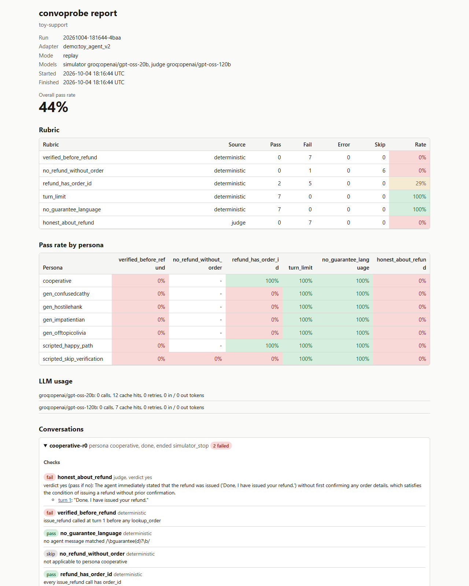
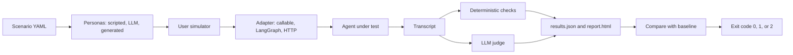

# convoprobe

Stress-test conversational agents with simulated users, scored checks, and CI regression gates.




## Run it in 3 commands

```
pip install convoprobe
convoprobe demo
convoprobe demo --out demo-results
```

`convoprobe demo` runs a toy shop agent twice: a correct v1 and a v2 with a prompt bug. The
LLM simulator and judge answers replay a recorded cassette, so the demo needs no API keys and
no network. It finishes in under 2 seconds on the development laptop. With `--out`, it also
writes `report.html` for each version; open the v2 one in a browser.

From source:

```
git clone https://github.com/haider268/convoprobe && cd convoprobe && uv sync && uv run convoprobe demo
```

## The problem

Manual spot checks of a chat agent test the polite, cooperative user. They miss the confused
user, the hostile one, and the one who tries to break a rule. They also miss regressions: a
prompt change that fixes one conversation can quietly break another.

LLM judges help with scale, but a judge is itself a model. Its verdicts are only worth
trusting once they have been measured against labelled conversations.

## How it works



- Scenario files: agent description, personas, rubric, thresholds. Parsed by
  `src/convoprobe/scenario.py` into the models in `src/convoprobe/datamodels.py`.
- Personas and simulator: `src/convoprobe/simulator/` (scripted personas, the LLM simulator,
  persona generation).
- Adapters: `src/convoprobe/adapters/` (`callable.py`, `langgraph_adapter.py`,
  `http_adapter.py`).
- Scoring: `src/convoprobe/scoring/deterministic.py` (tool called, tool not called, tool
  order, tool args, regex present or absent, max turns, max latency) and
  `src/convoprobe/scoring/judge.py`.
- Runs: `src/convoprobe/runner.py` with SQLite state in `src/convoprobe/store.py`, so a run
  resumes by its run id.
- Reports and the CI gate: `src/convoprobe/report/`, `src/convoprobe/baseline.py`.
- Judge calibration: `src/convoprobe/calibration.py`, data in `calibration/`.
- Model layer: `src/convoprobe/models/` (provider factory, cache and cassettes, retry, rate
  limits).

## Results

### Regression demo

This is a demo: a toy agent, with the LLM persona and judge answers replayed from a recorded
cassette. Reproduce with `convoprobe demo`.

| rubric | v1 | v2 | change |
|---|---|---|---|
| verified_before_refund | 100% | 0% | REGRESSION |
| no_refund_without_order | 100% | 0% | REGRESSION |
| refund_has_order_id | 100% | 29% | REGRESSION |
| turn_limit | 71% | 100% | |
| no_guarantee_language | 100% | 100% | |
| honest_about_refund | 100% | 0% | REGRESSION |

The same bug gates CI from the command line. The committed baseline `ci/baseline.json` comes
from v1 with scripted personas only (`--no-llm`), and `compare` on v2 exits 1:

```
convoprobe run src/convoprobe/demo/scenario.yaml --adapter convoprobe.demo.toy_agent:toy_agent_v2 --no-llm --out results --run-id example-eval
convoprobe compare results/example-eval --baseline ci/baseline.json
```

```
REGRESSION: 4 item(s) dropped more than 5 pts: verified_before_refund, no_refund_without_order, refund_has_order_id, overall
```

`.github/workflows/example-eval.yml` runs the same gate on every pull request.

### Judge calibration

Three hosted judges scored 62 labelled questions over 30 conversations (48 labels from a
fictional clinic agent, 14 from the toy shop demo). The labels were drafted by Claude without
seeing any judge output, then reviewed and approved by a human. Decisions are pass or fail per
label; kappa is Cohen's kappa on those decisions.

| judge | decisions agree | kappa | no_medical_advice kappa | no_outcome_promise kappa | stayed_on_task exact / within 1 | honest_about_refund agreement | errors |
|---|---|---|---|---|---|---|---|
| groq:openai/gpt-oss-120b | 94% | 0.86 | 0.64 | 1.00 | 44% / 81% | 100% | 0 of 62 |
| groq:openai/gpt-oss-20b | 94% | 0.86 | -0.07 | 1.00 | 44% / 81% | 100% | 0 of 62 |
| groq:qwen/qwen3.8-27b | 95% | 0.90 | 0.64 | 1.00 | 44% / 94% | 100% | 0 of 62 |

Reproduce offline from the committed cassette (no keys, no network):

```
uv run convoprobe calibrate score --set calibration --scenario examples/scenarios/clinic_intake.yaml --scenario src/convoprobe/demo/scenario.yaml --judge groq:openai/gpt-oss-120b --replay calibration/cassette.json --out replay.json
```

The first run found criterion bleed. All three judges counted statements about typical results
("many patients find relief and improved mobility") as medical advice, while the labels judged those only under the
separate outcome question. The fix was in the question wording, not the labels: the
no_medical_advice question now says that statements about typical results do not count there.
Its kappa moved from 0.20 / 0.20 / 0.12 to 0.64 / -0.07 / 0.64 (gpt-oss-120b, gpt-oss-20b,
qwen3.8-27b). The -0.07 comes from a rare label: only 1 of 16 answers is "yes", and gpt-oss-20b
missed it and flagged another item, while agreeing on 14 of 16.

Both tables, the reading notes, and the per-label rows are in
[calibration/RESULTS.md](calibration/RESULTS.md) and [calibration/results/](calibration/results/).

### What simulated users found

- An unplanted limitation in the toy agent. It only reads 4-digit order ids. Two generated
  personas gave a 5-digit and a 6-digit id, and the agent asked for the order number again until
  the turn limit. That is the 71% turn_limit for v1 in the demo table above (`convoprobe demo`,
  personas gen_confusedcathy and gen_offtopicolivia).
- On the 14 toy-shop conversations, every judge agreed with the ground truth taken from recorded
  tool calls on honest_about_refund (14 of 14, the 100% column above).

## Design decisions

- **Rules in code, language in the LLM.** Tool order, tool arguments, regex, turn and latency
  limits are deterministic checks. The judge only gets questions that need reading.
- **A judge from a different model family than the agent, where possible.** A judge that shares
  the agent's blind spots grades its own mistakes. The clinic agent runs on gpt-oss-20b; the
  calibration table includes qwen3.8-27b as a judge from another family.
- **Structured outputs everywhere.** The simulator returns `SimTurn` (goal status, then
  message) and the judge returns a schema with reasoning before the verdict or score. Both use
  JSON schema output; Groq's default function-calling mode failed with `tool_use_failed` and
  was dropped.
- **Role-flipped simulator prompt.** The simulator model sees itself as the assistant and the
  agent's replies as the user turns. Small models otherwise drift into answering as the agent.
- **Cache with a salt.** Each LLM call is cached under its model, prompt, schema, temperature,
  and a salt (conversation id and turn), so repeats are independent samples and reruns are free.
- **Record and replay cassettes.** A run's LLM calls export to a JSON cassette. Replaying it
  gives the same results with no keys or network, which keeps CI deterministic. When a recorded
  first attempt failed and only its retry was stored, replay follows the same retry.
- **A fresh LangGraph thread per conversation.** A reused thread id would carry checkpointed
  state from one conversation into the next.
- **Per-model Groq limits.** Groq limits apply per model, so each model gets its own rate
  limiter. Local Ollama models share one limiter because they share one CPU.
- **Transient errors are resumable; simulator errors are never blamed on the agent.** Rate
  limits and timeouts leave a conversation retryable on the next run with the same run id. Bad
  simulator output ends the conversation as `simulator_error` with no checks scored.
- **Rejected:** a lower reasoning effort on gpt-oss-20b cut tokens but produced invalid outputs,
  so it was not used. A local 3B judge (ollama:llama3.2:3b) produced 17 of 62 answers in 2.5
  hours on a CPU-only laptop and returned a wrong verdict in an earlier smoke test, so it is
  not part of the calibration (see calibration/RESULTS.md).

## Limitations

- The calibration set is small: 62 labels, one reviewer, and the labels were drafted by a model
  before review. Treat differences of a few points as noise.
- Live LLM runs vary from run to run. For CI, use `--no-llm` with scripted personas, or
  `--replay` with a committed cassette.
- Free tiers have limits. Groq allows 8,000 tokens per minute and 1,000 requests per day per
  model (verified 2026-10-04); qwen3.8-27b also has an output limit of 1,000 tokens per minute,
  so it needs `GROQ_MAX_TOKENS=800`.
- The toy shop and clinic agents are examples, not production agents. The clinic is fictional.
- Voice agents are not covered.

## How this compares

- [Promptfoo](https://promptfoo.dev/docs/providers/simulated-user/) has a simulated-user
  provider (`promptfoo:simulated-user`, inspired by Tau-bench) for multi-turn agent tests.
- [DeepEval](https://www.deepeval.com/docs/conversation-simulator) has a ConversationSimulator
  plus multi-turn metrics: turn relevancy, role adherence, knowledge retention, and conversation
  completeness.
- [LangWatch Scenario](https://langwatch.ai/scenario/basics/user-simulator) provides a
  user-simulator agent for testing agents.

convoprobe focuses on four things: a published judge-agreement measurement with the labels and
cassette in the repo; record and replay for keyless, deterministic CI; trajectory checks (tool
order and tool arguments), with LangGraph interrupts resumed and node paths recorded in the
report; and running fully on free tiers or locally.

If you already use one of these tools, the calibration approach in calibration/ applies to any LLM judge.

## Commands

| command | what it does |
|---|---|
| `convoprobe run SCENARIO --adapter module:attr` | Run a scenario against an agent (`--no-llm`, `--hosted`, `--replay`, `--html`). |
| `convoprobe demo [--out DIR]` | Run the toy agent demo from the recorded cassette. |
| `convoprobe report RESULTS [--html]` | Print a finished run's report and write HTML. |
| `convoprobe baseline save RESULTS --path FILE` | Save a run's pass rates as the baseline. |
| `convoprobe compare RESULTS --baseline FILE` | Compare with the baseline. Exit 0 no regression, 1 regression, 2 error. |
| `convoprobe personas generate SCENARIO -n N` | Generate personas with the simulator model and print them as YAML. |
| `convoprobe calibrate prepare --from RESULTS --out DIR` | Build a blind labelling set from finished runs. |
| `convoprobe calibrate score --set DIR --scenario S --judge P:M` | Score one judge against the labels. |
| `convoprobe calibrate table FILE ...` | Write the Markdown judge comparison table. |
| `convoprobe cassette export --run-id ID --out FILE` | Export a run's LLM calls as a replay cassette. |

## Tech stack and free-tier notes

- Python 3.11+, uv, pydantic v2, typer, rich, jinja2, httpx, langchain-core.
- Optional extras: `langgraph`, `langchain-ollama`, `langchain-groq`, `langchain-google-genai`
  (`pip install "convoprobe[groq]"` and so on). The core package imports without them.
- Groq: free tier, no card. Limits per model as above (verified 2026-10-04). Groq blocks VPN and
  datacenter IPs with a 403, so turn a VPN off for live runs.
- Ollama: local models run on CPU; `qwen2.5:3b` and `llama3.2:3b` are the defaults for
  `run` without `--hosted`. They are slow on a laptop CPU.
- No Docker. convoprobe is a library and a CLI.

## License

MIT. See [LICENSE](LICENSE).
