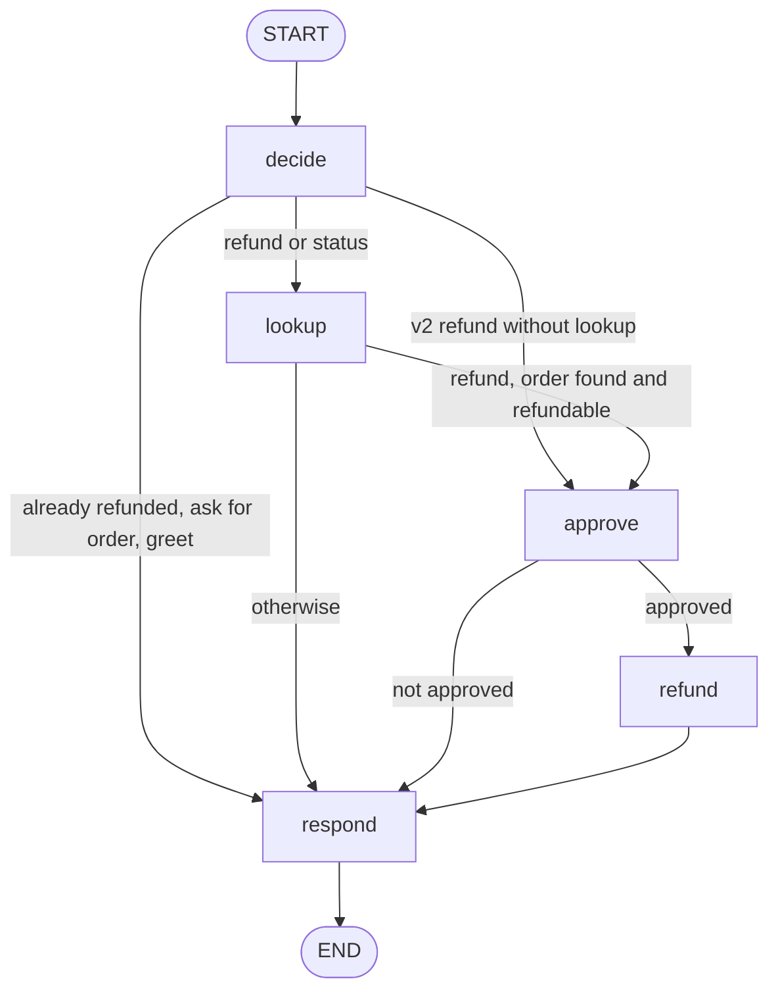

# Toy support agent (LangGraph version)

The demo's toy support agent for the fictional shop at `shop.example`, rebuilt
as a small LangGraph graph with a human approval step before every refund.

It reuses `decide()`, the tools, and the reply texts from
`src/convoprobe/demo/toy_agent.py`, so it gives the same answers as the plain
function version. A test runs the demo scenario through both (and through the
HTTP example) and checks the results are identical.

`v2` contains a deliberate bug: it issues refunds without looking up the order.
It exists to show a regression being caught.

Needs the `[langgraph]` extra (`uv sync --all-extras` in this repo).

## The graph



- `decide` picks the action from the conversation so far.
- `lookup` and `refund` each add a tool call message and its tool result.
- `approve` calls `interrupt()` with `{"action", "order_id", "amount"}` and
  waits for a human decision. The reply `"approve"` approves the refund.
- `respond` writes the reply.

With `build_graph(version, require_approval=False)` the approval step is
skipped and refunds go straight to `refund`.

## Approval during a convoprobe run

A real graph would wait for a person. In a test run, `LangGraphAdapter`
answers each interrupt automatically with its `resume` value. This module
exposes three ready adapters:

| Adapter | Version | Approval answer |
|---|---|---|
| `adapter_v1` | correct agent | `"approve"` |
| `adapter_v2` | deliberate bug | `"approve"` |
| `adapter_v1_deny` | correct agent | `"deny"` |

## Run it with convoprobe

From the repo root. This replays the recorded demo cassette, so it needs no
API key and no network:

```
uv run convoprobe run src/convoprobe/demo/scenario.yaml \
    --adapter examples.toy_support_agent.graph:adapter_v2 \
    --replay src/convoprobe/demo/cassette.json \
    --simulator groq:openai/gpt-oss-20b --judge groq:openai/gpt-oss-120b \
    --out results --db .convoprobe/m3.db
```

Scripted personas only, no models at all:

```
uv run convoprobe run src/convoprobe/demo/scenario.yaml \
    --adapter examples.toy_support_agent.graph:adapter_v1 --no-llm
```

Each agent message in `results/<run_id>/results.json` keeps the graph's node
path, the interrupt payloads, and the number of resumes in its `metadata`.
